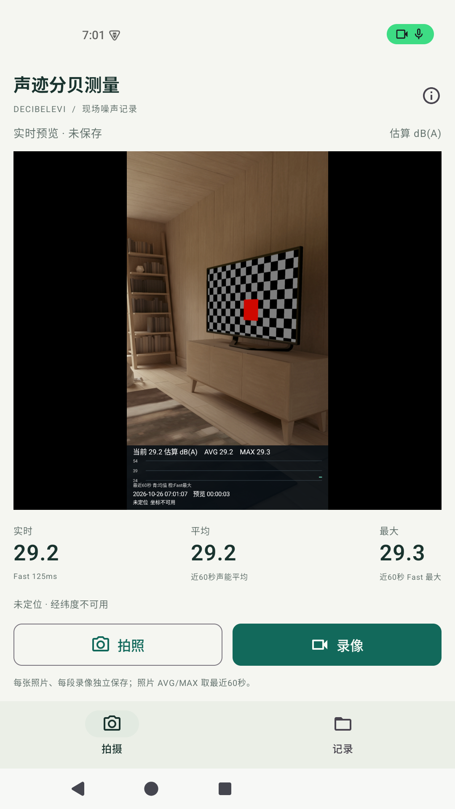
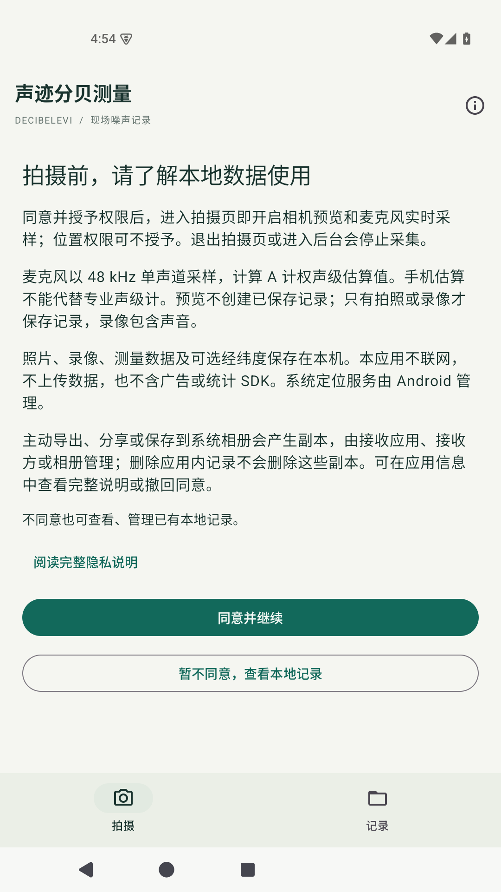
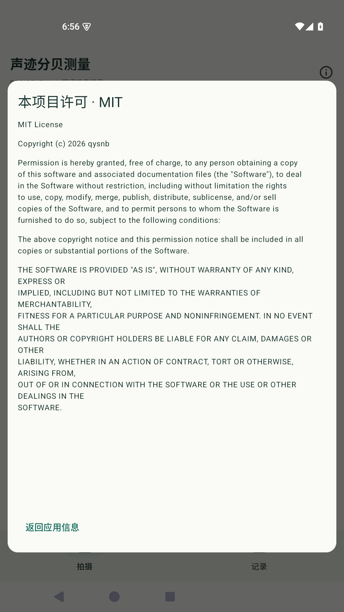

# 声迹分贝测量 · DecibelEvi

一款运行于 **Android 10 及以上**的中文噪声估算与现场拍摄工具。原生 Kotlin / Jetpack Compose，照片、视频和测量资料保存在本机；无账号、无广告、无付费或云存储。

[下载 APK](https://github.com/qysnb/DecibelEvi/releases) · [使用与测量口径](docs/MEASUREMENT.md) · [构建](docs/BUILD.md) · [隐私说明](docs/PRIVACY.md) · [反馈问题](https://github.com/qysnb/DecibelEvi/issues)

## 安装

在 [Releases](https://github.com/qysnb/DecibelEvi/releases) 下载 `.apk`。GitHub 自动提供的 `Source code.zip` 是源码，不是安装包。按手机提示允许所选浏览器或文件管理器安装外部应用；具体安全提示和安装结果由设备系统决定。

首次使用先阅读隐私说明，再决定是否开启相机和麦克风；位置权限可选。已有调试版与正式版签名不同，可能无法覆盖安装。重要记录请先导出备份，卸载会删除应用内部数据。

当前首发是 **0.1.6 公测版**。请阅读 [验证状态](docs/VALIDATION.md)，不要将手机估算值用于替代专业鉴定。

## 功能

- 相机预览就能看到水印，拍照和有声录像将水印永久写入像素。
- 当前声级、AVG 声能平均、MAX Fast 最大值、最近60秒曲线。
- 日期时间、录制时长、经纬度、精度以及未定位/旧定位/大致位置状态。
- 每张照片、每段录像独立记录；录像中也可拍照。
- 应用内查看照片、播放视频、重命名；清空名称恢复日期时间标题。
- 单个或批量保存到系统相册 `DCIM/DecibelEvi`。
- 导出媒体、逐秒 CSV、元数据与 SHA-256 清单的完整 ZIP。

拍摄页在同意说明并授予必要权限后实时采样；预览不会保存音视频。点击拍照或录像才创建记录。进入后台、锁屏或关键资源中断会结束采集，本版不支持后台持续录像。

## 界面预览

以下为Android15无GMS模拟器中的真实应用界面，仅展示功能，不代表真实声学精度或物理设备测试结果。预览示例未授予定位权限。

<p>



</p>

## 测量边界

采用 48 kHz / 16位 / 单声道 PCM、A频率计权与125 ms Fast时间计权。同一路PCM用于测量和视频音轨。优先使用 UNPROCESSED，回退 VOICE_RECOGNITION，记录实际输入方式。

默认以Android标称麦克风灵敏度换算并标为 **估算 dB(A)**；不同设备增益和声学结构不同，本项目不保证专业声压级精度。AVG采用声能平均，MAX为LAFmax，不是瞬时声压峰值。照片AVG/MAX取快门前60秒内有效完整秒，视频统计从该段开始重新计算。详情见[测量说明](docs/MEASUREMENT.md)。

设备时间和系统定位不属于可信时间/地点认证；文件哈希只能检查内容是否变化。没有专业计量或司法鉴定认证，不保证投诉或诉讼结果。

## 构建与结构

安装 JDK 17、Android SDK Platform 35 和 Build Tools 36.1.0，在 Android Studio 打开本目录。构建与测试：

```powershell
.\gradlew.bat :core:test :app:testDebugUnitTest :app:lintDebug :app:assembleDebug
python -m unittest discover -s tools/tests -v
```

Linux/macOS 使用 `./gradlew`。完整说明和本地签名方式见 [BUILD.md](docs/BUILD.md)。

- `core/`：可独立测试的频率/时间计权、声能统计和照片窗口。
- `app/`：Compose页面、Camera2/OpenGL合成、AudioRecord、MediaCodec/MediaMuxer、Room及文件导出。
- `tools/`：取证包校验、依赖许可审计和本地调试辅助。
- `docs/`：测量、构建、隐私、验证及架构说明。

## 许可证与贡献

自研代码及本仓库原创文档按 [MIT License](LICENSE) 提供，**允许商业使用、修改和再分发**，须保留版权及许可声明。第三方组件保留各自许可，见 [THIRD_PARTY_NOTICES.txt](THIRD_PARTY_NOTICES.txt) 和应用内第三方许可入口。

欢迎提交可复现的问题和小范围修复；见 [CONTRIBUTING.md](CONTRIBUTING.md)。请勿在公开 Issue 附上身份证、真实坐标、私人录音/视频或未脱敏日志。安全问题见 [SECURITY.md](SECURITY.md)。
